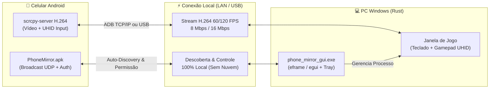

<div align="center">

# 📱⚡ PhoneMirror

**Espelhamento e controle de celulares Android no Windows a até 120 FPS — feito para jogar e usar o celular no PC sem complicação e 100% sem assinatura.**

[-0a84ff?style=for-the-badge&logo=windows&logoColor=white)](./PhoneMirror_Setup.exe)
[](./PhoneMirror.apk)
[](./Cargo.toml)
[](./Cargo.toml)
[-30d158?style=for-the-badge)](#por-que-o-phonemirror)

<p align="center">
  <a href="./PhoneMirror_Setup.exe"><strong>⬇️ Baixar Instalador Windows (PhoneMirror_Setup.exe)</strong></a> •
  <a href="./PhoneMirror.apk"><strong>📲 Baixar App Android (PhoneMirror.apk)</strong></a> •
  <a href="./index.html"><strong>🌐 Site de Apresentação</strong></a> •
  <a href="./politica-privacidade.html"><strong>🛡️ Privacidade (LGPD)</strong></a>
</p>

</div>

---

## 🎯 Por que o PhoneMirror?

A maioria dos programas de espelhamento cobra mensalidade para liberar 60/120 FPS, adiciona marca d'água, exige conta na nuvem ou obriga você a digitar endereços IP toda vez. O **PhoneMirror** resolve isso com um motor nativo em **Rust** + pipeline de vídeo **scrcpy H.264**:

- **Zero Assinatura, Zero Conta, Zero Anúncios:** Tudo liberado localmente na sua máquina.
- **120 FPS & 16 Mbps (Modo Gamer):** Baixíssima latência via **Cabo USB** ou **Wi-Fi 5 GHz**, ideal para jogos competitivos e uso diário.
- **Teclado e Gamepad UHID Nativo:** Controle jogos e apps com periféricos reconhecidos pelo Android como hardware físico (`--keyboard=uhid`, `--gamepad=uhid`).
- **Descoberta Automática na Rede (Zero IP):** O app Android anuncia o aparelho pelo nome real na rede local; o PC encontra em 1 clique.
- **Autorização com 1 Toque:** Popup de confirmação na tela do celular antes de iniciar qualquer transmissão Wi-Fi.
- **Modo Tela Apagada:** Continue usando e jogando pelo monitor do PC com a tela física do celular desligada para economizar bateria e evitar aquecimento.
- **Bandeja do Sistema (System Tray):** Fechar a janela mantém o PhoneMirror leve em segundo plano, pronto para reconectar.

---

## 📦 Executáveis e Downloads Diretos

Os binários prontos para uso estão incluídos diretamente na raiz do repositório:

| Arquivo | Plataforma | Tamanho Aprox. | Descrição |
| :--- | :--- | :---: | :--- |
| **[`PhoneMirror_Setup.exe`](./PhoneMirror_Setup.exe)** | Windows 10 / 11 (x64) | ~8.5 MB | Instalador completo com interface gráfica nativa (`phone_mirror_gui.exe`), atalhos e desinstalador. |
| **[`PhoneMirror.apk`](./PhoneMirror.apk)** | Android 8.0+ | ~6.6 MB | App Companion para descoberta automática via Wi-Fi, exibição do nome do aparelho e controle de autorização/parada. |
| **[`iniciar_phonemirror.bat`](./iniciar_phonemirror.bat)** | Windows (Script) | < 1 KB | Atalho rápido para iniciar ou compilar em modo portátil. |

> [!TIP]
> **Dependência de Vídeo (`scrcpy`):** O PhoneMirror utiliza o motor `scrcpy` para decodificação H.264 de baixa latência. Se ainda não o tiver instalado no Windows, rode no PowerShell ou Terminal:
> ```powershell
> winget install Genymobile.scrcpy
> ```
> O PhoneMirror detecta automaticamente o executável instalado pelo WinGet ou no `PATH`.

---

## 🚀 Como Usar em 3 Passos

### Opção A — Sem Fio (Wi-Fi)
1. **No Celular:** Ative a **Depuração por Wi-Fi** (ou porta TCP 5555 via Depuração USB na primeira vez) nas *Opções do Desenvolvedor* e abra o app **`PhoneMirror.apk`**.
2. **No PC:** Abra o **PhoneMirror**, selecione a aba **Wi-Fi** e clique em **🔍 Varredura** (a busca também ocorre automaticamente).
3. **Conecte e Jogue:** Clique em **Conectar** no card do seu aparelho, toque em **Permitir** no alerta do celular e a tela abrirá imediatamente a até **120 FPS**.

### Opção B — Cabo USB (Latência Zero)
1. **No Celular:** Ative a **Depuração USB** nas *Opções do Desenvolvedor* e conecte o cabo ao PC.
2. **No PC:** Mude para a aba **Cabo USB** no PhoneMirror e clique em **Conectar**.
3. **Pronto:** Autorize a chave RSA na tela do celular (apenas na 1ª vez) e jogue sem atraso.

> [!IMPORTANT]
> No modo Wi-Fi, o computador e o celular devem estar conectados à **mesma rede local (mesmo roteador)**. Para 120 FPS estáveis sem fio, recomenda-se rede **Wi-Fi 5 GHz**.

---

## ⚡ Recursos Técnicos em Destaque



### Arquitetura do Workspace (Rust)
O projeto é modularizado em *crates* independentes dentro de [`crates/`](./crates):
- **[`crates/adb`](./crates/adb)** — Cliente ADB assíncrono, varredura de pacotes UDP do app Companion, handshake de autorização e ativação automática de TCP/IP (`5555`).
- **[`crates/player`](./crates/player)** — Interface gráfica nativa (`eframe`/`egui`), gerenciamento de janela Win32, ícone na bandeja (`tray-icon`), deduplicação mDNS/IP e orquestração de sessões a 60/120 FPS.
- **[`crates/protocol`](./crates/protocol)**, **[`crates/transport`](./crates/transport)**, **[`crates/media`](./crates/media)**, **[`crates/input`](./crates/input)**, **[`crates/session`](./crates/session)** — Módulos base de protocolo, transporte de pacotes, mídia e injeção de eventos.
- **[`android-companion`](./android-companion)** — Código-fonte do aplicativo Android Companion que gera o [`PhoneMirror.apk`](./PhoneMirror.apk).

---

## 🌐 Site de Apresentação Interativo

O repositório conta com uma landing page moderna, tecnológica e interativa com animações e simulador da interface real:
- **Arquivo:** [`index.html`](./index.html)
- **Visualização Local:** Basta abrir o arquivo [`index.html`](./index.html) em qualquer navegador moderno ou publicar via **GitHub Pages** diretamente da branch principal.

---

## 🛠️ Compilação Manual (Desenvolvedores)

Caso queira compilar o executável Windows e o instalador a partir do código-fonte:

```powershell
# 1. Compilar o binário GUI otimizado (Release)
cargo build --release -p phone_mirror_player --bin phone_mirror_gui

# 2. Executar diretamente
.\target\release\phone_mirror_gui.exe
```

Para gerar novamente o instalador [`PhoneMirror_Setup.exe`](./PhoneMirror_Setup.exe), utilize o **Inno Setup 6** com o script [`installer.iss`](./installer.iss).

---

## 🛡️ Privacidade e Segurança (LGPD)

- **Processamento 100% Local:** Nenhum frame de vídeo, áudio, toque ou dado pessoal passa por servidores externos.
- **Consentimento Explícito:** O celular solicita permissão na tela antes de abrir o espelhamento por Wi-Fi e permite encerrar a transmissão a qualquer momento.
- Consulte os termos completos em [`politica-privacidade.html`](./politica-privacidade.html).

---

<div align="center">

Desenvolvido por **Rafael Franchini (R4LF)**  
[🐙 GitHub (@Rafael-Franchini)](https://github.com/Rafael-Franchini) • [💼 LinkedIn](https://www.linkedin.com/in/rafael-franchini-37b0a21a4/)

</div>
